## Pregunta de partida

> Si dos características de una población cambian juntas, ¿qué podemos decir sobre su relación? ¿Hasta dónde podemos usarla para predecir?

Antes de abrir Colab, trabajaremos tres ideas: cómo reconocer una asociación en un gráfico, qué resume una correlación y cómo interpretar una recta de regresión.

## ¿En los países con más ingresos se vive más?

Cada punto es uno de **195 países y economías** con datos de 2024. El eje horizontal mide el ingreso nacional por habitante, ajustado por poder de compra; el vertical, la esperanza de vida al nacer.

```{r}
#| dev: svglite
#| fig-width: 9
#| fig-height: 3.4
#| out-height: 380px
#| fig-align: center
#| fig-alt: "Nube de ingreso por habitante y esperanza de vida en 2024, con una tendencia ascendente que se aplana."
library(ggplot2)
paises <- read.csv("figuras-correlacion/ingreso-esperanza-vida-2024.csv")
ggplot(paises, aes(ingreso / 1000, esperanza_vida)) +
  geom_point(colour = "#176B73", size = 2, alpha = .65) +
  labs(x = "Ingreso nacional por habitante (miles de d\u00f3lares internacionales)",
       y = "Esperanza de vida al nacer (a\u00f1os)") +
  theme_minimal(base_size = 13)
```

**Para leer la nube:** ¿qué significa que un país esté arriba y a la izquierda? ¿La asociación parece seguir una recta?

## Ingresos distintos, esperanzas de vida parecidas

| País | Ingreso por habitante (dólares internacionales) | Esperanza de vida (años) |
|:---|---:|---:|
| Nicaragua | 8.280 | 75,1 |
| Costa Rica | 28.980 | 81,0 |
| Chile | 34.390 | 81,4 |
| Estados Unidos | 85.270 | 78,9 |

**En duplas:** ¿qué les llama la atención al comparar Chile y Estados Unidos? ¿Qué información buscarían para entender las diferencias: acceso a salud, saneamiento, desigualdad u otra?

Datos 2024: Banco Mundial, [ingreso nacional por habitante](https://data.worldbank.org/indicator/NY.GNP.PCAP.PP.CD) y [esperanza de vida](https://data.worldbank.org/indicator/SP.DYN.LE00.IN). [Preston (1975)](https://doi.org/10.1080/00324728.1975.10410201) estudió esta relación entre países.

## Una nube ilustrativa

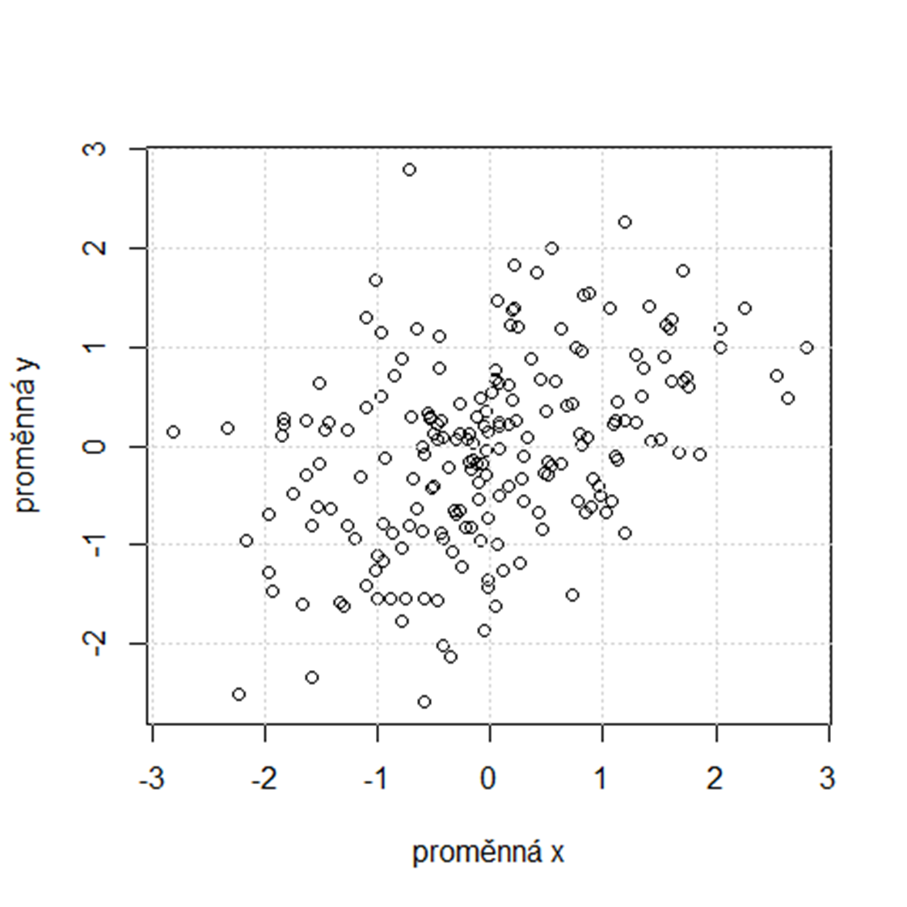{height=365px fig-alt="Nube de puntos con asociación positiva y dispersión apreciable"}

Esta nube es **un caso distinto** al gráfico de países. Sirve para practicar cómo se lee una asociación entre dos variables, $X$ e $Y$, sin asignarles una unidad concreta.

**En duplas:** al movernos a la derecha, ¿los puntos tienden a subir o a bajar? ¿Todos siguen el mismo patrón?

::: {.notes}
Los puntos tienden a subir, aunque hay dispersión: observaciones con valores parecidos de X pueden tener valores distintos de Y.
:::

## Dos asociaciones positivas

:::: {.columns}
::: {.column width="50%"}
{height=345px fig-alt="Nube con mayor dispersión alrededor de la tendencia"}
:::
::: {.column width="50%"}
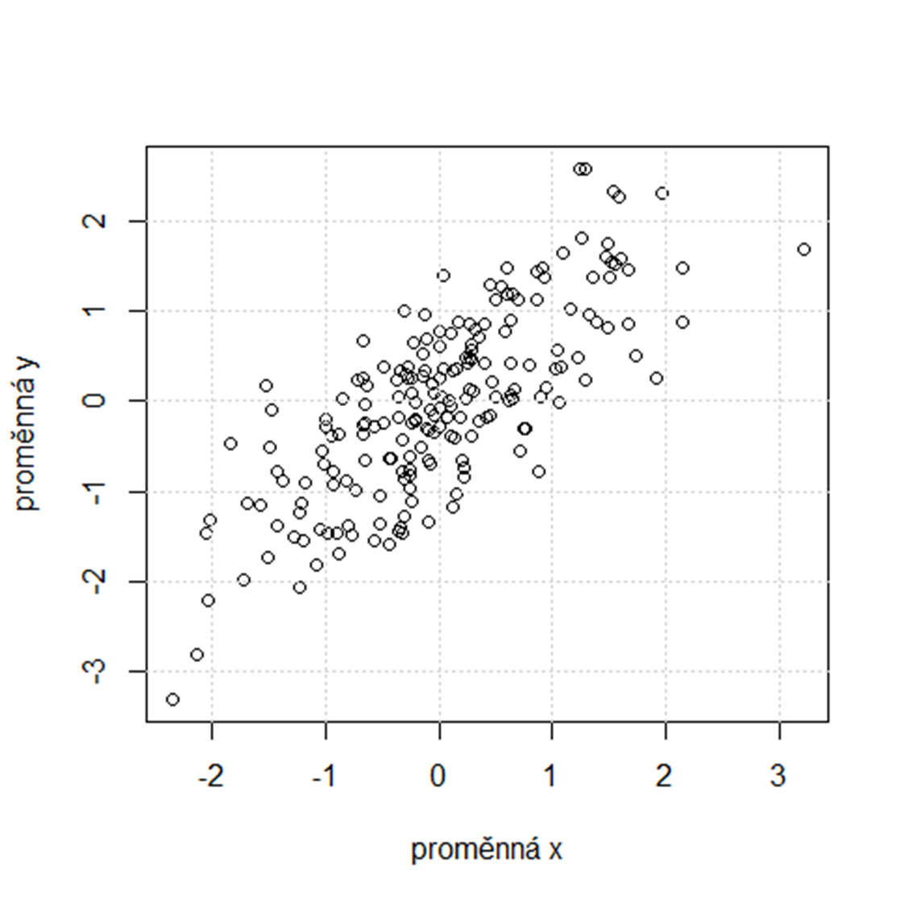{height=345px fig-alt="Nube más estrecha alrededor de una tendencia ascendente"}
:::
::::

Son dos nubes ilustrativas. **¿En cuál los puntos se acercan más a una recta?** ¿Cambia la dirección de la relación o cambia lo dispersos que están los puntos?

::: {.notes}
En la nube de la derecha los puntos están más cerca de una recta. En ambas la asociación es positiva.
:::

## 1. Leer una nube de puntos

Suiza, hacia 1888. Cada punto representa un **distrito**, no una persona. **X:** porcentaje de reclutas que estudiaron más allá de la primaria. **Y:** índice de fecundidad; más arriba significa mayor fecundidad.

```{r}
#| fig-width: 8
#| dev: svglite
#| fig-height: 3.3
#| out-height: 325px
#| fig-align: center
#| fig-alt: "Nube de 47 distritos. La fecundidad tiende a disminuir a medida que aumenta la escolaridad."
library(ggplot2)
suiza <- datasets::swiss
nube <- ggplot(suiza, aes(Education, Fertility)) +
  geom_point(colour = "#176B73", size = 2.5, alpha = .8) +
  labs(x = "Reclutas con educaci\u00f3n posterior a primaria (%)",
       y = "\u00cdndice estandarizado de fecundidad") +
  theme_minimal(base_size = 13)
nube
```

**En duplas:** ¿qué distrito tendría más escolaridad: uno a la izquierda o uno a la derecha? Al ir hacia la derecha, ¿los puntos tienden a subir o a bajar? ¿Todos siguen ese patrón?

::: {.notes}
La nube muestra una tendencia descendente: en general, los distritos con mayor escolaridad registran menor fecundidad. También hay dispersión: distritos con escolaridad similar pueden tener valores de fecundidad distintos.
:::

## 2. Resumir la asociación con una correlación

Una correlación resume la **dirección** y la **intensidad** de un tipo de asociación. Sus valores van de −1 a 1: el signo indica la dirección y la distancia a cero indica qué tan marcada es la asociación que mide ese coeficiente. No hay umbrales universales para decidir qué es «fuerte»; importa el contexto de investigación.

## ¿Qué medida elijo?

| Si tengo… | Y quiero saber… | Parto con… |
|:---|:---|:---|
| Dos variables cuantitativas, como edad e ingreso | Si la nube sigue aproximadamente una recta. | **Pearson** |
| Dos cuantitativas, como ingreso y esperanza de vida | Si al subir una, la otra tiende a subir o bajar, aunque la nube se curve. | **Spearman** |
| Una o dos variables ordinales, como pertenencia baja, media o alta | Si quienes están más arriba en una variable también tienden a estar más arriba en la otra. | **Spearman** |
| Dos variables que se pueden ordenar | Si, al comparar dos personas, su orden coincide en ambas variables. | **Kendall** |

**Ordinal** significa que hay un orden, pero no sabemos si la distancia entre categorías es la misma. Spearman y Kendall permiten empates; una variable nominal, como la comuna, no tiene un orden natural.

## Spearman y Kendall con las mismas personas

**Participación barrial, de menor a mayor:** Ana → Beto → Carla → Diego. Ahora ordenamos a las mismas personas por **pertenencia al barrio**:

| Orden por pertenencia, de menor a mayor | ¿Qué cambió? | Spearman | Kendall |
|:---|:---|---:|---:|
| Beto → Ana → Diego → Carla | Se invierten dos pares. Cada persona cambia un puesto. | 0,60 | 0,33 |
| Beto → Carla → Ana → Diego | También se invierten dos pares. Ana cambia dos puestos. | 0,40 | 0,33 |

**En duplas:** ¿por qué Kendall queda igual, pero Spearman baja?

::: {.notes}
En ambos ejemplos coinciden cuatro de seis pares y se invierten dos. En el primero se invierten Ana–Beto y Carla–Diego; en el segundo, Ana–Beto y Ana–Carla. Kendall cuenta los pares invertidos. Spearman también refleja cuánto se mueven las personas en el orden. Es un ejemplo ficticio sin empates.
:::

## ¿Cómo explico el resultado?

| Si obtengo… | Puedo decir… |
|:---|:---|
| **Pearson −0,66** · Escolaridad y fecundidad en Suiza | Los distritos con mayor escolaridad tienden a tener menor fecundidad. La relación lineal es negativa. |
| **Spearman 0,60** · Participación y pertenencia | Quienes están más arriba en participación tienden a estar más arriba en pertenencia. |
| **Kendall 0,33** · El mismo ejemplo barrial | De los seis pares, cuatro coinciden en el orden: quien participa más también reporta mayor pertenencia. En los otros dos se invierte el orden. |

**Spearman y Kendall coinciden en la dirección.** Que 0,60 sea mayor que 0,33 no significa que uno haya encontrado una relación más fuerte: resumen cosas distintas.

## Pearson: desviaciones respecto de la media

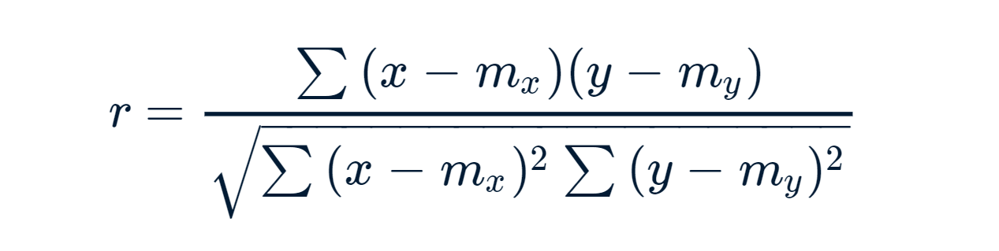{height=110px fig-alt="Fórmula de Pearson en la notación de la figura"}

$$
r=\frac{\sum_{i=1}^{n}(x_i-\bar x)(y_i-\bar y)}
{\sqrt{\sum_{i=1}^{n}(x_i-\bar x)^2\sum_{i=1}^{n}(y_i-\bar y)^2}}
$$

Cada observación aporta el producto de sus desviaciones respecto de las dos medias. El denominador pone el resultado en una escala común.

## Spearman: correlación entre rangos

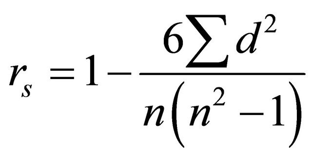{height=95px fig-alt="Fórmula abreviada de Spearman sin empates"}

En general, $r_s=\operatorname{cor}_{\mathrm{Pearson}}(R_X,R_Y)$, donde $R_X$ y $R_Y$ son los rangos. Si no hay empates:

$$
r_s=1-\frac{6\sum_{i=1}^{n}d_i^2}{n(n^2-1)},
\qquad d_i=R_{X,i}-R_{Y,i}.
$$

Con empates, asignamos rangos promedio y calculamos Pearson sobre esos rangos.

## Kendall: pares concordantes y discordantes

- **Concordante ($C$):** al comparar dos observaciones, la que tiene mayor $X$ también tiene mayor $Y$.
- **Discordante ($D$):** la que tiene mayor $X$ tiene menor $Y$.

Sin empates, hay $n(n-1)/2$ pares posibles:

$$
\tau=\frac{C-D}{n(n-1)/2}.
$$

Si hay empates, la variante $\tau_b$ ajusta el denominador para tenerlos en cuenta.

## Cinco patrones de correlación

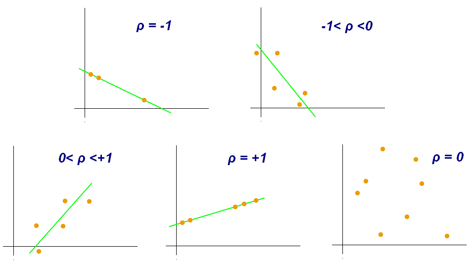{height=345px fig-alt="Cinco nubes: correlación negativa perfecta, negativa, positiva, positiva perfecta y cercana a cero"}

Aquí, $\rho$ indica la correlación lineal. **Si la nube baja**, el signo es negativo; **si sube**, es positivo. En −1 y +1, todos los puntos caen sobre una recta. Cerca de cero no hay una tendencia **lineal** clara, aunque podría haber una curva.

**Pregunta:** en los dos gráficos ascendentes de abajo, ¿qué cambia: el signo o lo cerca que están los puntos de una recta?

## Cómo interpretar el coeficiente

**Ejemplo:** con escolaridad y fecundidad, Pearson da aproximadamente **−0,66**. El signo coincide con lo que vimos en el gráfico. El número no indica cuánto disminuye la fecundidad por cada punto porcentual de escolaridad: esa pregunta corresponde a la pendiente de una regresión.

**Para discutir:** si un gráfico forma una U, ¿una correlación lineal cercana a cero permite decir que las variables no se relacionan? Vuelvan al gráfico antes de responder.

## 3. Distinguir asociación de causalidad

Que la escolaridad y la fecundidad se relacionen entre distritos no demuestra que la primera haya causado cambios en la segunda. Por ejemplo, la urbanización podría estar relacionada con ambas. Para sostener una explicación causal necesitaríamos justificar qué ocurrió primero, proponer un mecanismo y contar con un diseño que permita evaluar explicaciones alternativas.

Además, los puntos representan **distritos, no personas**. Una asociación a nivel territorial no permite concluir que las personas con más escolaridad tuvieran menos hijos.

**Pregunta para el curso:** imaginen dos variables de su propia encuesta que podrían estar asociadas. Propongan una tercera variable que ayudaría a interpretar ese patrón.

## Correlaciones espurias

Una **correlación espuria** es una asociación observada que se presta a una interpretación engañosa. Puede aparecer por azar, por una causa común o porque dos series comparten una tendencia en el tiempo.

**Ejemplo para debatir:** los recuentos de cigüeñas y de nacimientos pueden coincidir entre regiones. ¿Podría el tamaño de la población, la extensión rural u otra característica territorial explicar parte del patrón?

**Tres preguntas antes de hablar de causa:** ¿qué ocurrió primero?, ¿qué mecanismo conectaría las variables?, ¿qué otra explicación debemos descartar?

## Piscinas y películas de Nicolas Cage

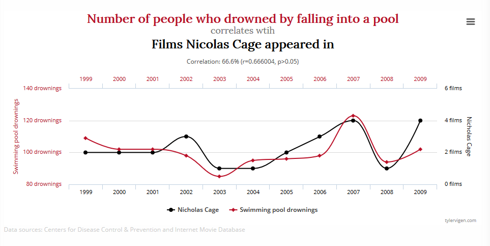{height=395px fig-alt="Comparación anual entre ahogamientos por caídas en piscinas y películas con Nicolas Cage"}

**Rojo:** ahogamientos por caídas en piscinas. **Negro:** películas en las que apareció Nicolas Cage. Cada serie tiene su propia escala. ¿Qué haría falta para sostener que una causa la otra?

## Mozzarella y doctorados en ingeniería civil

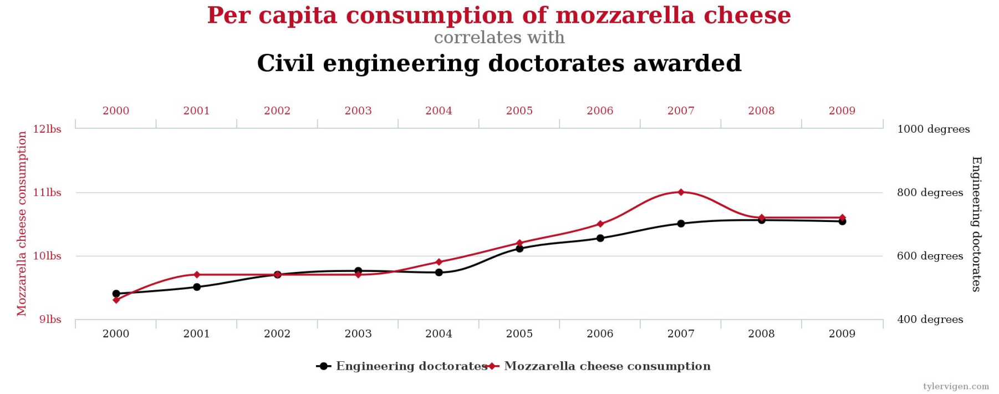{height=395px fig-alt="Dos series temporales, consumo de mozzarella y doctorados en ingeniería civil, suben en el periodo mostrado"}

**Rojo:** consumo de mozzarella por persona. **Negro:** doctorados otorgados en ingeniería civil. Si ambas series crecen con el tiempo, ¿qué comparación ayudaría a descartar una tendencia compartida?

## ¿La clase ayudó?

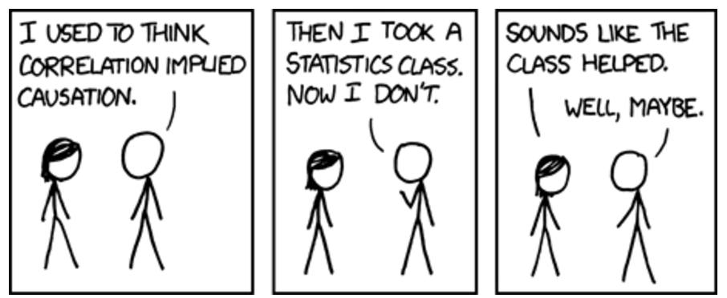{width=960px fig-alt="Viñeta sobre una persona que dejó de confundir correlación y causalidad tras tomar un curso"}

Una persona dice que antes confundía correlación y causalidad, pero dejó de hacerlo tras un curso de estadística. Su interlocutor concluye que el curso ayudó. La respuesta: **«Bueno, tal vez»**.

## 4. Pasar de la nube a una recta

Con la correlación, intercambiar las variables no cambia el coeficiente. En una regresión elegimos qué queremos predecir: la fecundidad es el **resultado** $Y$ y la escolaridad es el **predictor** $X$.

```{r}
#| fig-width: 8
#| dev: svglite
#| fig-height: 3.3
#| out-height: 380px
#| fig-align: center
#| fig-alt: "La nube de distritos con una recta descendente superpuesta."
nube + geom_smooth(method = "lm", formula = y ~ x, se = FALSE,
                   colour = "#A14225", linewidth = 1.15)
```

## La ecuación de regresión

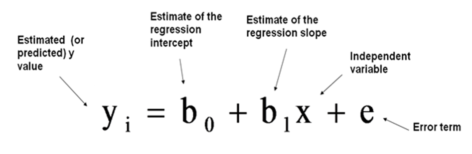{height=205px fig-alt="Ecuación que identifica el resultado, el intercepto, la pendiente, el predictor y el término de error"}

$$
Y_i=\beta_0+\beta_1X_i+\varepsilon_i,
\qquad
\widehat{Y}_i=b_0+b_1X_i.
$$

La primera ecuación describe el modelo con un término de error. La segunda es la **recta estimada**: $b_0$ es el intercepto y $b_1$ es la pendiente.

## Intercepto y pendiente

La recta estimada es $\widehat{Y}=79{,}61-0{,}862X$. El símbolo $\widehat{Y}$ distingue el valor **ajustado por el modelo** del valor observado $Y$.

- **Intercepto ($b_0$):** fecundidad estimada cuando la escolaridad vale cero. Aquí es 79,61; conviene interpretarlo con cautela porque cero está fuera del rango observado.
- **Pendiente ($b_1$):** cambio estimado en $Y$ por una unidad adicional de $X$. Aquí, un punto porcentual más de escolaridad se asocia con **0,86 puntos menos en el índice** de fecundidad.

**Ejercicio oral:** si dos distritos difieren en 10 puntos porcentuales de escolaridad, ¿en cuánto difieren sus valores ajustados? Expliquen el signo y las unidades.

## ¿Cuánto cambia Y cuando X aumenta una unidad?

**La pendiente es ese cambio en el valor estimado de Y.** Para pasar de una unidad a varias, multiplicamos la pendiente por el cambio en X: $\Delta\widehat Y=b_1\,\Delta X$.

| Ejemplo | Aumento en X | Cambio estimado en Y |
|:---|:---|:---|
| Escolaridad y fecundidad | De 20 % a 21 %: **1 punto porcentual** | **−0,86 puntos** en el índice de fecundidad |
| Edad e ingreso | De 19 a 20 años: **1 año** | **+2,75 unidades** de ingreso posterior |

**Para comprobarlo:** ¿cuánto cambiaría el índice estimado si la escolaridad pasara de 20 % a 25 %? Comparen dos valores de la recta; la pendiente por sí sola no demuestra un efecto causal.

## Residuos y calidad del ajuste

- **Residuo:** distancia vertical con signo entre un punto y la recta: valor observado menos valor ajustado. Si el punto está por encima de la recta, el residuo es positivo.
- **$R^2$:** proporción de la variación observada de $Y$ que recoge la recta en estos datos. Aquí es aproximadamente **0,44**. No mide un efecto causal ni el porcentaje de predicciones acertadas.

**¿Por qué esa recta?** Mínimos cuadrados elige la recta que hace lo más pequeña posible la suma de los residuos al cuadrado. Elevarlos al cuadrado evita que los positivos y negativos se cancelen y da más peso a las distancias grandes.

## Valor observado, ajustado y residuo

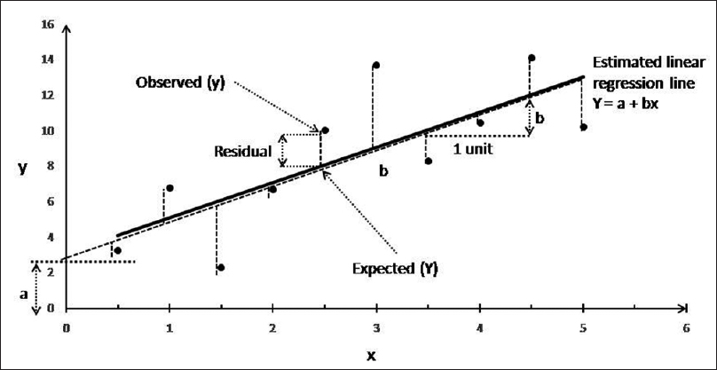{height=410px fig-alt="Recta ajustada y segmentos verticales entre valores observados y ajustados"}

Los segmentos verticales muestran residuos. ¿Cuál tiene signo negativo? ¿Qué distancia representa la pendiente cuando $X$ aumenta una unidad?

## Fórmulas del ajuste

**Residuo:** $e_i=y_i-\widehat y_i$. **Mínimos cuadrados:** elegir $b_0$ y $b_1$ para minimizar $\sum_i e_i^2$.

$$
b_1=\frac{\sum_i (x_i-\bar x)(y_i-\bar y)}{\sum_i (x_i-\bar x)^2},
\qquad b_0=\bar y-b_1\bar x.
$$

$$
R^2=1-\frac{\sum_i(y_i-\widehat y_i)^2}{\sum_i(y_i-\bar y)^2}.
$$

$R^2$ compara el error de la recta con el error de usar la media de $Y$ como predicción para todos los casos.

## Ejemplo: edad e ingreso posterior

:::: {.columns}
::: {.column width="22%"}
**Datos**

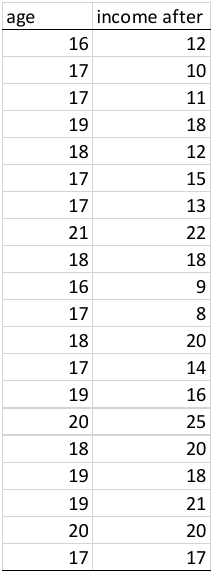{height=360px fig-alt="Tabla de 20 pares de edad e ingreso posterior"}
:::
::: {.column width="10%"}
{width=72px fig-alt="Flecha de los datos al gráfico"}
:::
::: {.column width="68%"}
**Edad en años e ingreso posterior**

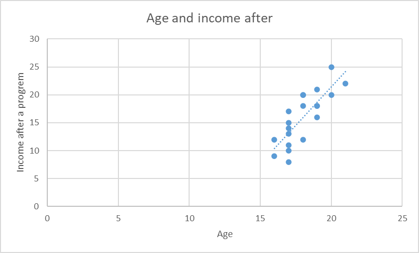{height=345px fig-alt="Nube de edad e ingreso posterior con una recta ascendente"}
:::
::::

**Eje X:** edad. **Eje Y:** ingreso posterior al programa. ¿Qué edades están representadas?

## ¿Qué predice la recta a los 20 años?

La recta estima el **ingreso posterior al programa** a partir de la edad. Partimos del intercepto (−33,55) y sumamos **2,75 por cada año** de edad. Para una persona de 20 años, multiplicamos la pendiente por 20:

$$
\widehat{\text{Ingreso}}=-33{,}55+(2{,}75\times20)=-33{,}55+55=21{,}45.
$$

En la tabla hay dos personas de 20 años, con ingresos de **20 y 25**. El **21,45** viene de la recta ajustada a **todos** los puntos: no es lo que ganó una persona en particular.

## ¿Y si usamos la recta a los 29 años?

$$
\widehat{\text{Ingreso a los 29 años}}=-33{,}55+2{,}75\times29=46{,}20.
$$

Las edades observadas van de **16 a 21 años**. A los 20 estamos dentro del rango; a los 29 estamos fuera. El cálculo da **46,20**, pero solo si suponemos que el patrón sigue igual más allá de los datos. Eso es **extrapolar**.

## El cachorro y la extrapolación

:::: {.columns}
::: {.column width="42%"}
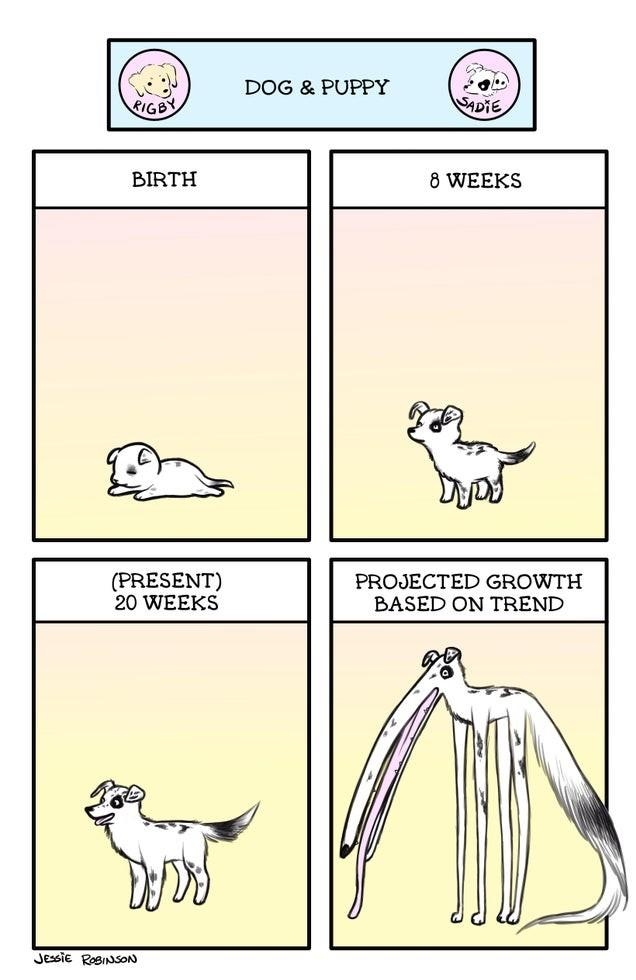{height=440px fig-alt="Viñeta que extrapola el crecimiento de un cachorro hasta un tamaño absurdo"}
:::
::: {.column width="58%"}
Los primeros tres cuadros muestran al cachorro al nacer, a las 8 y a las 20 semanas. **El cuarto es una proyección:** si siguiera creciendo al mismo ritmo, terminaría con patas descomunales.

El chiste muestra el problema: al acercarse a la adultez, el crecimiento se desacelera. Del mismo modo, no sabemos si la relación entre edad e ingreso sigue igual después de los 21 años.
:::
::::

## 5. Predecir e identificar cuándo extrapolamos

Usando la recta, podemos estimar el valor ajustado para un distrito con 10 % de escolaridad: $79{,}61-0{,}862\times10\approx71$. La recta da un valor central; un distrito concreto puede estar por encima o por debajo.

En los datos, la escolaridad va de **1 % a 53 %**. Una predicción al 50 % cae dentro del rango observado; una al 90 % es una **extrapolación**. Podemos extender la recta en el papel, pero no sabemos si el patrón se mantiene allí.

## Antes de abrir Colab

Expliquen en una frase cada idea: **correlación**, **pendiente** y **predicción**. ¿Qué advertencia agregarían al interpretar una predicción al 90 % de escolaridad?

En el **cuaderno de Colab**, volveremos a estas preguntas con R: construiremos la nube, compararemos coeficientes, ajustaremos la recta y examinaremos la incertidumbre de las predicciones.

Datos: [Swiss Fertility and Socioeconomic Indicators (1888), documentación de R](https://stat.ethz.ch/R-manual/R-devel/library/datasets/html/swiss.html).

## Preguntas

{height=420px fig-alt="Perro con signos de interrogación"}
